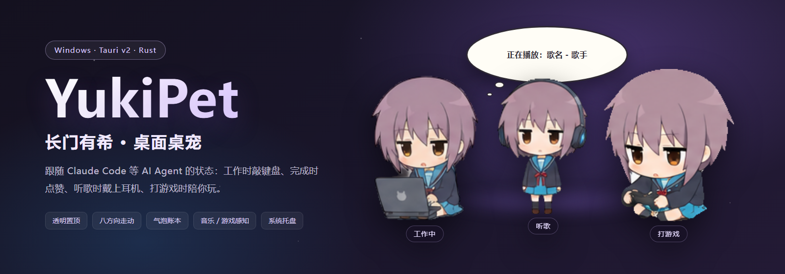

# YukiPet · 长门有希桌宠

跟随 AI Agent 状态的 Windows 桌面桌宠。她会在你让 Claude Code 干活时敲键盘，任务完成时点赞，听歌时戴上耳机，打游戏时陪你玩。

Tauri v2 + Rust + Canvas 精灵动画，透明置顶、点击穿透、多显示器、托盘常驻。



## 功能

### 跟随 Agent 状态

| 状态 | 触发 | 表现 |
| --- | --- | --- |
| 空闲 | `SessionStart` / `SessionEnd` / 空闲等待 / 10 分钟无事件 | 呼吸眨眼 |
| 工作中 | `UserPromptSubmit` / `PreToolUse` / `PostToolUse` | 敲键盘，气泡透传工具名 |
| 等你确认 | `Notification`（权限/确认） | 红色「等你确认」气泡 |
| 成功 / 失败 | `Stop`（本轮有工具报错则失败） | 点赞 / 抱膝 |
| 听歌 | 系统媒体检测到音乐播放 | 戴上耳机定格 |
| 游戏 | 前台进程命中游戏目录 | 手柄循环 / 胜负 / 被打扰 |

- 工作气泡会显示 agent 正在使用的工具名（`Bash…`、`Edit…`），成功/失败/结束会随动作结束收起。
- 超过 10 分钟没有任何事件会自动回到空闲，避免 agent 进程被强杀后卡在工作态。
- 听歌时 agent 的气泡仍然实时提醒，且优先于音乐气泡。

### 桌面互动

- 16 帧走路循环（素材朝右，向左自动镜像），支持八方向随机游走，不会走出屏幕。
- 13 组小动作随机播放，每 15–60 秒触发一次，每次完整播放一组。
- 拖拽移动时播放挣扎动画；放下后恢复当前状态（工作中/游戏中/听歌中）。
- 点头部 = 摸头，双击 = 惊讶；位置和设置保存在本地，重启不会跳回默认位置。
- 右键菜单：调整大小（拖动条，45%–75%）、随机走动、总在最前、点击穿透、播报间隔、音乐/游戏播报、开机自启、退出。
- 系统托盘：显示/隐藏桌宠、点击穿透开关、退出；单实例保护，重复启动会直接退出。
- 连续工作 45 分钟提醒休息。

### 气泡账本

- 点击桌宠打开紧凑椭圆气泡：DeepSeek 账户余额、今日消费、近 30 天消费金额与 token 用量。
- 不抢前台键盘焦点；10 秒自动收起，点击账本外或拖动也会立即关闭。
- 每 5 分钟自动播报一次（间隔可在右键菜单调整或关闭）。

### 音乐 / 游戏感知

- 音乐：优先读取 Windows 系统媒体会话（SMTC，只认音乐类应用）；网易云等不注册 SMTC 的播放器用窗口标题兜底，并用 WASAPI 音频会话是否活跃来判断暂停。
- 播放音乐 → 第 1 组「戴上耳机」开场一次 → 固定为第 8 帧听歌姿势；切歌气泡显示「正在播放：歌名 - 歌手」5 秒，名字太长会自动缩小字号完整显示；暂停/关闭直接回到空闲。
- 游戏：检测前台进程是否位于 Steam / Epic / GOG / WeGame / Riot / Battle.net / Xbox 或包含 `\games\` 的路径；开始动画 → 游戏循环 → 1–5 分钟随机胜负/被打扰动作。点击身体显示游戏名，点头部立即被打扰。退出判定有 6 秒防抖。
- 优先级：音乐动画 > 游戏/Agent 动画；Agent 状态气泡始终优先展示。

## 下载 / 直接运行

**便携版（Windows x64，无需安装）**：[`release/YukiPet-v0.1.0-windows-x64.zip`](release/YukiPet-v0.1.0-windows-x64.zip)

1. 解压后双击 `YukiPet.exe`。
2. 需要 Windows 10/11 x64 与 WebView2 运行时（Win11 自带；Win10 可从 [微软官网](https://developer.microsoft.com/microsoft-edge/webview2/) 安装）。
3. exe 未签名，首次运行可能触发 SmartScreen：选择「更多信息」→「仍要运行」。
4. 首次启动出现在屏幕右下角；右键桌宠或托盘图标可调整设置。
5. 压缩包内附 `install-hooks.bat`（需要 Node.js），双击即可接入 Claude Code。

> 便携版把前端和素材一起嵌进了 exe，拷贝到其他机器也能直接运行。后续版本会优先发布到 GitHub Releases。

## 从源码运行

环境要求：

- Windows 10/11 x64
- Node.js 18+
- Rust stable（MSVC toolchain）
- Visual Studio Build Tools，勾选「使用 C++ 的桌面开发」
- WebView2 Runtime（Win11 自带）

```bash
git clone https://github.com/zlc0099/yuki.git
cd yuki
npm install
npm run dev
```

开发模式会打开透明置顶的桌宠窗口；改 Rust 代码 `tauri dev` 会自动重启，改前端或素材后重启一次 `npm run dev` 生效。

## 接入 Claude Code

```bash
npm run hooks:install     # 备份并合并写入 ~/.claude/settings.json（幂等）
npm run hooks:uninstall   # 移除本项目写入的 hooks
```

- 安装器会备份原 `settings.json`，不会覆盖你自己的其它 hooks。
- hooks 脚本在桌宠未运行时静默跳过，不影响 Claude Code。
- 仓库移动过位置后，重新执行一次 `hooks:install` 即可更新脚本路径。

## 接入其它 Agent

桌宠启动后会在本机 `127.0.0.1` 开一个事件服务，任何 agent 只要 POST JSON 就能复用同一套动画：

```bash
# 端口和 token 在启动时生成
PORT=$(cat "$LOCALAPPDATA/yukipet/port.txt")
TOKEN=$(cat "$LOCALAPPDATA/yukipet/token.txt")

curl -s -X POST "http://127.0.0.1:$PORT/event" \
  -H "content-type: application/json" \
  -H "x-pet-token: $TOKEN" \
  -d '{"agent":"my-agent","event":"PreToolUse","session_id":"demo","tool":"Bash"}'
```

完整字段、事件语义和示例见 [docs/event-protocol.md](docs/event-protocol.md)。Codex / Trae 等适配器尚未内置，但协议已经可以直接接入。

## 数据与隐私

- **余额查询**：仅当本机 `~/.claude/settings.json` 配置了 DeepSeek（`ANTHROPIC_BASE_URL` 包含 `deepseek.com`）时，读取本机 `ANTHROPIC_AUTH_TOKEN` 并向 DeepSeek 官方余额接口查询；密钥只在内存中使用，不写入日志、不上传到其它地方。非 DeepSeek provider 会显示不可用。
- **用量统计**：今日/近 30 天消费与 token 从本机 Claude 配置目录统计，不联网上传。消费按本地记录的余额变化估算，充值会让数字偏小。
- **音乐/游戏检测**：只读取系统媒体会话、窗口标题、音频会话状态和前台进程路径，不采集音频或屏幕内容。
- 事件服务只监听 `127.0.0.1`，每次启动随机生成 token，请求必须携带 `x-pet-token`。

## 构建

```bash
# 便携版 exe（前端和素材嵌入二进制，单个文件直接运行）
npm run build:portable
# 输出：src-tauri/target/release/yuki-pet.exe

# 普通 Tauri 构建（当前 bundle.active=false，不生成安装包）
npm run build
```

重新切分精灵图（需要 `ziyuan/` 和根目录的原始素材）：

```bash
npm run slice
# 输出到 src/assets/sprites/，并更新 manifest.json
```

## 项目结构

```
src/                     前端页面与状态机（pet / card / toast / panel）
src/assets/sprites/      切好的精灵帧和 manifest（构建时嵌入 exe）
src-tauri/               Rust：透明置顶窗口、托盘、本地事件服务、媒体与游戏检测
hooks/                   Claude Code hook → 本地事件服务
tools/                   切图脚本、hooks 安装器、CDP 调试辅助
docs/                    预览图与事件协议文档
ziyuan/                  原始素材（切图输入）
release/                 便携版压缩包
```

## 素材与版权

- 角色「长门有希」出自《凉宫春日的忧郁》，角色版权归原作者及版权方所有。
- 本项目为非官方粉丝作品，精灵素材由项目作者整理/切分，仅供学习与个人使用，**请勿商用或二次售卖**。
- 代码部分未附带开源许可证（All rights reserved）。如需引用或二次开发，请先联系仓库作者。

## 已知限制

- 未做像素级透明区域穿透：目前是整窗「点击穿透」开关（托盘或右键菜单）。
- 全屏应用自动隐藏尚未实现。
- 开机自启只对打包后的 release 版有效。
- 失败判定是启发式（本轮工具报错）。
- 素材只有侧视行走帧，上下方向游走仍播放侧走动画（左右自动镜像）。
- 余额查询仅支持 DeepSeek。
- Codex / Trae 适配器尚未内置，可通过事件协议自行接入。

---

如果这个桌宠让你的 agent 工作过程更有趣，欢迎点个 Star。
